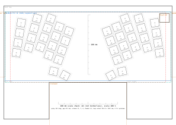

# mnhTTn48 unibody

Unibody variant of the [mnhTTn48](https://github.com/venc0r/mnhttn) split keyboard,
made to sit on top of a notebook keyboard (Dell XPS 13 9300, MacBook Pro 14 2026).

* mnhTTn48 key positions, reduced to 5x4+2 per side (44 keys), Cherry MX ULP switches, mnhTTn48 keycaps
* Both halves on one PCB, 20 degree splay per half, re-gret style finger splay (pinky 11, ring 4)
* Fits the MacBook Pro 14 keyboard well, clear of Touch ID, speakers and trackpad
* One Seeed XIAO nRF52840 BLE + 74HC595 shift register, 8x6 matrix, ZMK
* 2.0 mm PCB with a flat underside, rests on the deck above the keyboard and on the palm rest
  beside the trackpad, so the notebook keys are never touched

Status: planning, see [agent.md](agent.md).

## Layout
mnhTTn48 key positions are the source of truth (`tools/keys-mnhttn48.json`, extracted from the
parent board). The generator drops the extra inner key and the innermost thumb key of each
half, fans the finger columns like ergogen does for the
[re-gret](https://github.com/rschenk/re-gret), rotates each half inward around its inner top
corner, centres the result in the notebook's keyboard well (`tools/notebooks.json`) and writes
a 1:1 print for the paper fit test plus the key positions for the board:

```sh
tools/extract_keys.py ../mnhttn/board/mnhttn.kicad_pcb        # only after the parent layout changed
tools/layout.py                                               # docs/images/layout.svg, board/layout.json
tools/layout.py --splay 20 --gap auto --column-splay 11,-7,-4 --thumb-shift 8,1   # the defaults
tools/layout.py --notebook xps13                              # same keys in the XPS 13 envelope
```

`--column-splay` is ergogen style: pinky to inner, each relative to the previous column.
`--gap auto` widens the halves until a key cell would leave the usable area or touch a keep-out
(on the MacBook that is Touch ID). Key cells outside the envelope or inside a keep-out are reported.

Print `docs/images/layout.pdf` at 100 % (A4 landscape, the board outline is centred on the page)
and check both 100 mm rulers (trackpad notch, between the halves), measured from the long tick
at 0 to the long tick at 100. Paper size plain A4, not
"borderless" (that enlarges about 3 %), scale 100 %, not "fit". Print the PDF, not the SVG: the macOS print
dialog shrinks SVGs to the printable area (about 1 %). `tools/svg_to_pdf.py` writes the PDF without
external tools and asks the viewer not to scale it.



## Schematic
Generated, not drawn: `tools/gen_schematic.py` writes the root sheet, the switch sub-sheet and
the project file into [board/](board/). The matrix is one 74HC595 (8 driven columns) x 6 XIAO
inputs, see `tools/matrix.json`. Check with

```sh
tools/gen_schematic.py
kicad-cli sch erc --severity-all board/mnhttn48-unibody.kicad_sch
```

## PCB
Generated as well: `tools/gen_pcb.py` places the switches from `board/layout.json`, the diodes
in two blocks between the halves, the XIAO in the top left corner (USB-C out of the left edge,
reachable while typing), the shift register between the halves and routes the whole matrix. It
needs KiCad's own Python (pcbnew), `tools/drc.sh` wraps generation and DRC:

```sh
tools/drc.sh            # regenerate board/mnhttn48-unibody.kicad_pcb and print the DRC summary
tools/drc.sh details    # every violation with coordinates
```

KiCad 10 project in [board/](board/), footprints in `board/mnhttn.pretty` (copied from mnhTTn48
plus SOIC-16, 0603 and SOD-323 from the KiCad library). 2.0 mm, 2 layers.

## Keycaps
Unchanged, use the [mnhTTn48 keycaps](https://github.com/venc0r/mnhttn/tree/main/keycaps).

## Firmware
ZMK shield `mnhttn48_unibody` in [zmk-config/](zmk-config/) (todo).
